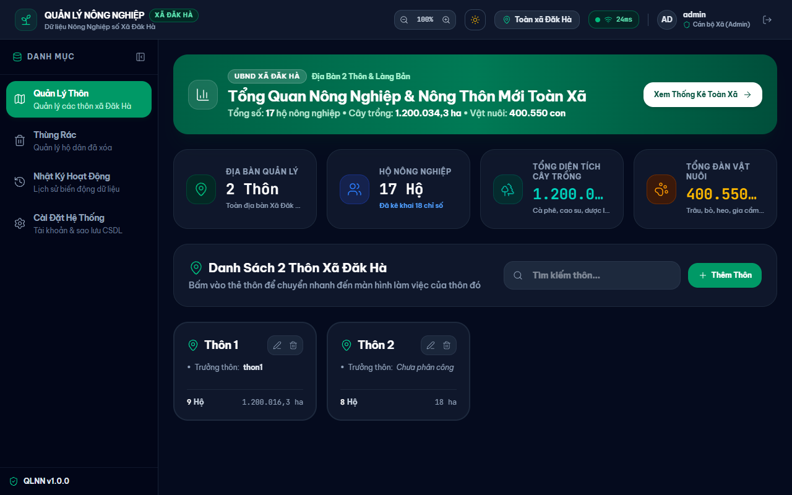
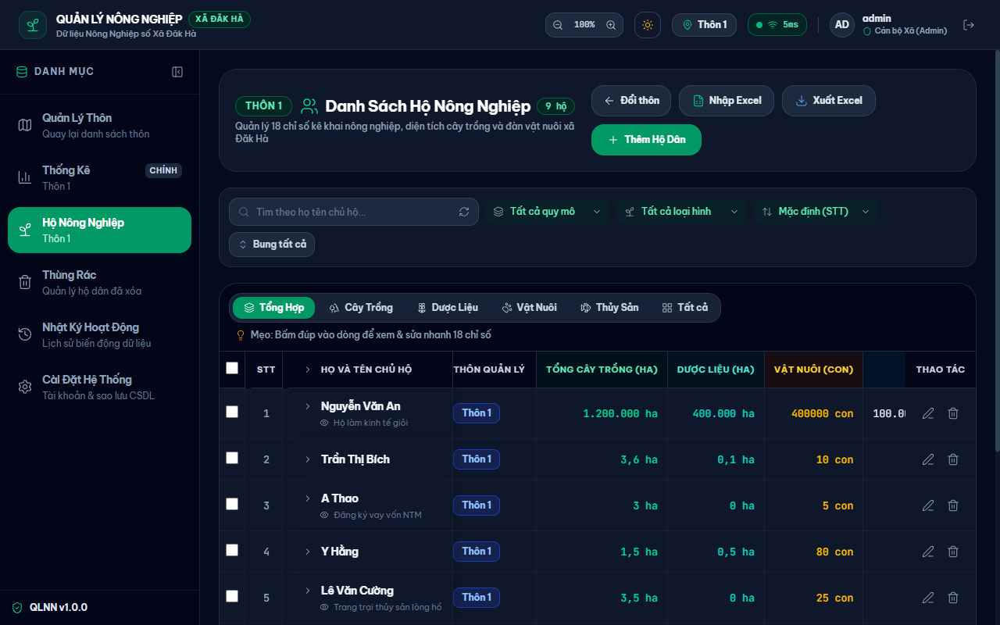
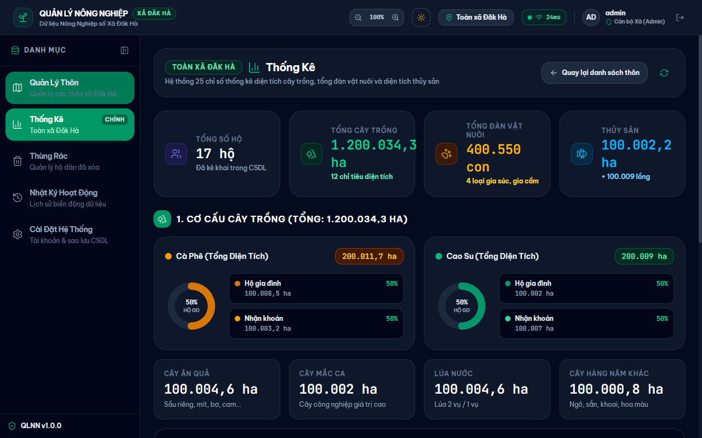
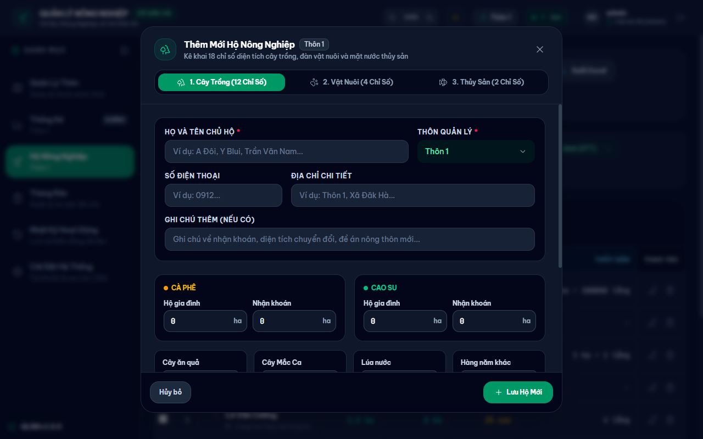
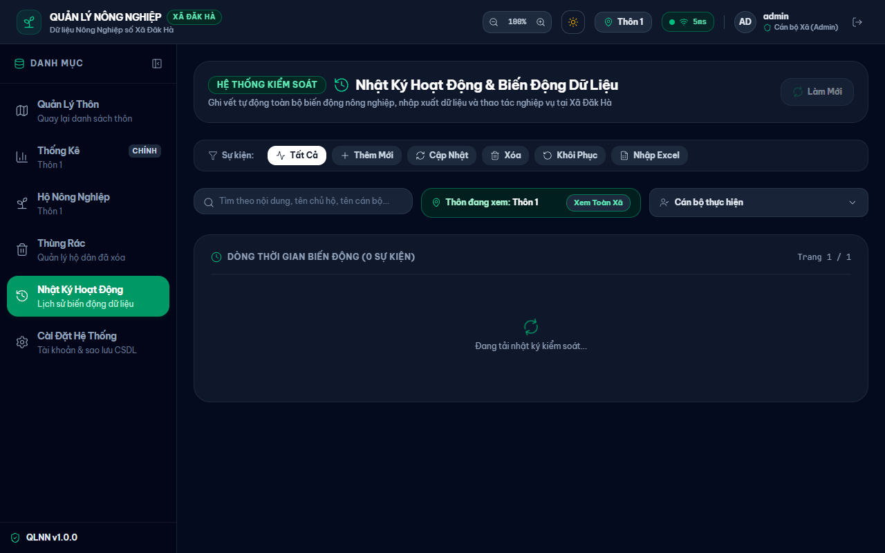
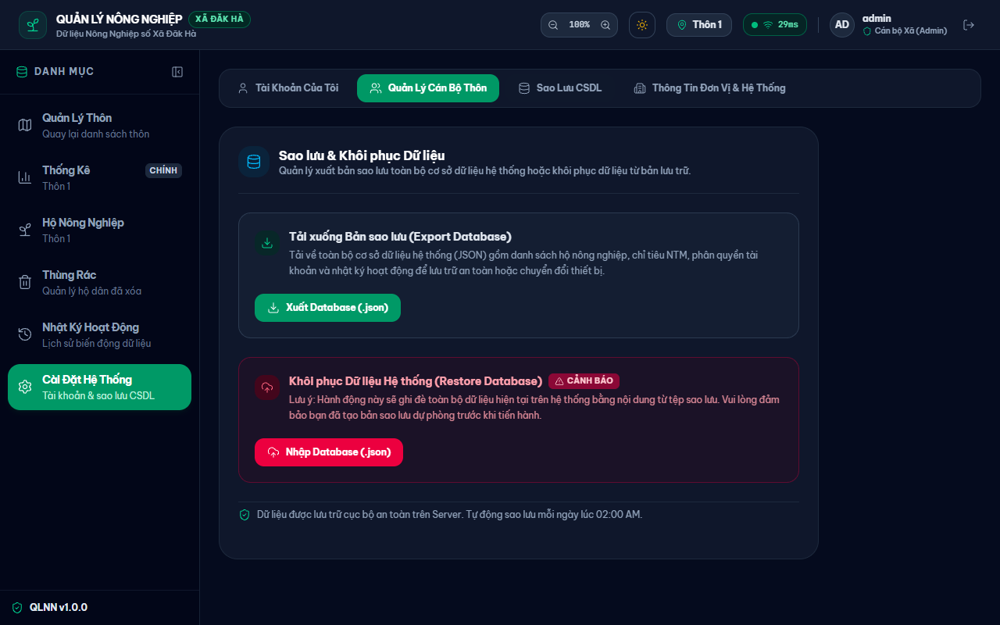
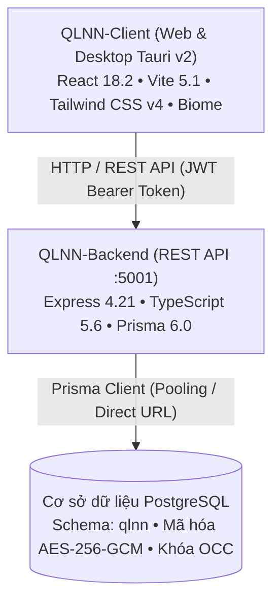

# Quản lý Nông nghiệp & Nông thôn mới — Xã Đăk Hà (QLNN)

Hệ thống số hóa chuyên ngành và quản trị 18 chỉ tiêu nông nghiệp, kiểm soát cơ cấu kinh tế nông thôn mới và phân tích đối soát dòng thời gian tại Xã Đăk Hà, Huyện Đăk Hà, Tỉnh Kon Tum.


> [!IMPORTANT]
> **Bản quyền thuộc Ủy ban nhân dân Xã Đăk Hà, Huyện Đăk Hà, Tỉnh Kon Tum và Tác giả (Umnuar).**  
> Mọi quyền được bảo lưu. Dự án này là phần mềm nội bộ chuyên dụng, KHÔNG áp dụng giấy phép mã nguồn mở tự do (không dùng MIT, Apache, GPL). Chi tiết xem tại mục [Giấy phép và bản quyền](#10-thong-tin-duy-tri--ban-quyen-phap-ly).

---

## Mục lục

- [1. Tổng quan & Hệ sinh thái số hóa công vụ Xã Đăk Hà](#1-tong-quan--he-sinh-thai-so-hoa-cong-vu-xa-dak-ha)
- [2. Ảnh chụp màn hình](#2-anh-chup-man-hinh)
- [3. Tính năng chính](#3-tinh-nang-chinh)
- [4. Kiến trúc hệ thống & Bảng công nghệ](#4-kien-truc-he-thong--bang-cong-nghe)
- [5. Bắt đầu nhanh](#5-bat-dau-nhanh)
- [6. Cấu trúc thư mục](#6-cau-truc-thu-muc)
- [7. Bảo mật, An toàn thông tin & Giới hạn đã biết](#7-bao-mat-an-toan-thong-tin--gioi-han-da-biet)
- [8. Thông tin duy trì & Bản quyền pháp lý](#8-thong-tin-duy-tri--ban-quyen-phap-ly)

---

## 1. Tổng quan & Hệ sinh thái số hóa công vụ Xã Đăk Hà

**QLNN** là phân hệ phần mềm công vụ số hóa chuyên sâu, phục vụ công tác điều hành của Lãnh đạo UBND Xã, Cán bộ phụ trách Nông nghiệp - Địa chính và Ban Quản lý 7 Thôn, Làng bản tại Xã Đăk Hà. Hệ thống chuyển đổi toàn diện phương thức quản lý thống kê nông thôn truyền thống từ sổ sách, bảng tính Excel phân tán sang mô hình dữ liệu tập trung, có kiểm soát phân quyền địa bàn, chống xung đột ghi đè đồng thời và hỗ trợ phân tích đối soát dòng thời gian.

### Hệ sinh thái số hóa công vụ Xã Đăk Hà

| Ứng dụng | Tên đầy đủ | Vai trò chính | Kho lưu trữ |
| :--- | :--- | :--- | :--- |
| **QLCS** | Quản lý Chính sách | Chế độ người cao tuổi, chúc thọ, hưu trí xã hội | [Umnuar/QLCS](https://github.com/Umnuar/QLCS) |
| **QLHK** | Quản lý Hộ khẩu | Dữ liệu dân cư, nhân hộ khẩu, biến động cư trú | [Umnuar/QLHK](https://github.com/Umnuar/QLHK) |
| **QLNN** | Quản lý Nông nghiệp | Quy hoạch 18 chỉ tiêu nông nghiệp, cây trồng, vật nuôi | [Umnuar/QLNN](https://github.com/Umnuar/QLNN) |
| **Unified-Portal** | Cổng Hợp Nhất | Trạm điều phối dịch vụ, giám sát tiến trình và sao lưu | Nội bộ |

---

## 2. Ảnh chụp màn hình

| Tổng quan 7 thôn và các chỉ số kinh tế nông nghiệp | Danh sách hộ nông nghiệp và bộ lọc 18 chỉ tiêu |
| :---: | :---: |
|  |  |

| Thống kê toàn xã & Time-Travel Analytics 3D | Biểu mẫu kê khai hộ nông nghiệp 18 chỉ số |
| :---: | :---: |
|  |  |

| Nhật ký biến động và kiểm toán dữ liệu (Audit Log) | Sao lưu & Khôi phục dữ liệu an toàn (2FA / Mật khẩu) |
| :---: | :---: |
|  |  |

---

## 3. Tính năng chính

### Quản lý nghiệp vụ chuyên ngành nông nghiệp
- **Quản lý toàn diện 18 chỉ số nông nghiệp**: Theo dõi chi tiết 12 loại cây trồng (cà phê hộ, cà phê nhận khoán, cao su hộ, cao su nhận khoán, cây ăn quả, mắc ca, đinh lăng, gừng, nghệ, sả, lúa nước, cây hàng năm khác), 4 loại đàn vật nuôi (trâu, bò, heo, gia cầm) và 2 loại hình thủy sản (ao cá, lồng bè).
- **Phân loại hình thức sở hữu & canh tác**: Phân tách minh bạch diện tích đất tự chủ của hộ gia đình và diện tích đất liên kết nhận khoán từ các nông trường/công ty lâm nông nghiệp.
- **Quản lý địa bàn 7 thôn**: Phân cấp dữ liệu theo 7 đơn vị cơ sở (Thôn 1, Thôn 2, Thôn 3, Thôn 4, Thôn 5, Kon Đao Yôp, Kon Hnông Bách).
- **Thùng rác & Khôi phục phân tầng (Soft-delete & Cascade Restore)**: Chống xóa nhầm dữ liệu; cho phép khôi phục đơn lẻ hoặc khôi phục hàng loạt kèm bảo toàn nguyên vẹn cây chỉ số cây trồng, vật nuôi liên kết.

### Xử lý dữ liệu & Bảng tính thông minh
- **Nhập xuất Excel 21 cột chuẩn hóa**: Khớp chuẩn biểu mẫu hành chính 21 cột của UBND Xã Đăk Hà; cung cấp đường dẫn tải biểu mẫu mẫu trực tiếp `/Bieu_Mau_Nong_Nghiep.xlsx`.
- **Phân tích Smart-Upsert trong Web Worker**: Xử lý nạp dữ liệu nền thông qua Web Worker chuyên dụng (`excelImportWorker.ts`), tự động đối chiếu họ tên chủ hộ và thôn để phân loại tạo mới hoặc cập nhật mà không làm nghẽn giao diện.
- **Hộp thoại xem trước đối soát 21 cột (ImportPreviewModal)**: Bảng xem trước dữ liệu tải lên có cố định 2 cột đầu (Số thứ tự và Họ tên chủ hộ), hiển thị sai khác trực quan và cảnh báo dữ liệu không hợp lệ trước khi xác nhận lưu vào CSDL.

### Bảo mật & Kiểm soát truy cập
- **Mã hóa thông tin liên lạc (AES-256-GCM)**: Số điện thoại chủ hộ được mã hóa đối xứng AES-256-GCM với Vector khởi tạo (IV) ngẫu nhiên; che mờ hiển thị dạng `******1234` trên toàn bộ giao diện làm việc.
- **Tìm kiếm bảo toàn tính riêng tư (Blind Index)**: Sử dụng HMAC-SHA256 kết hợp chuỗi khóa bí mật (Pepper) để tạo chỉ mục tìm kiếm số điện thoại mà không cần giải mã hàng loạt trong CSDL.
- **Khóa lạc quan (OCC - Optimistic Concurrency Control)**: Quản lý phiên bản bản ghi bằng trường số nguyên `version: Int`; tự động phát hiện xung đột khi có nhiều cán bộ cùng sửa một hộ (mã lỗi HTTP 409 Conflict) và cung cấp nút nạp lại số liệu tức thì.
- **Phân quyền theo phạm vi địa bàn (RBAC Scoping)**: Khóa cứng quyền hạn của Cán bộ Thôn chỉ được thao tác trên dữ liệu thôn được phân công; chỉ tài khoản Quản trị viên (Admin) mới có thẩm quyền truy cập toàn xã và xóa vĩnh viễn.

### Quản trị, Thống kê & Phân tích chuyên sâu
- **Phân tích biến động dòng thời gian (Time-Travel Analytics)**: So sánh đối soát biến động nông nghiệp giữa hai mốc thời gian bất kỳ (Mốc Gốc A vs Mốc Đối Soát B) với giao diện chọn ngày `SmartDatePicker` và popover lưới tháng/năm.
- **Phân rã chi tiết dữ liệu (Drill-Down Modal)**: Nhấp trực tiếp vào từng chỉ số KPI chênh lệch để mở danh sách phân rã các hộ dân đóng góp vào mức tăng/giảm diện tích hoặc đàn vật nuôi.
- **Nhật ký kiểm toán biến động (Audit Log)**: Ghi nhận vết lịch sử mọi thao tác (Thêm, Sửa, Xóa, Khôi phục, Nhập Excel) kèm giao diện hiển thị sai khác trước và sau (Visual Diff).
- **Hỗ trợ làm việc ngoại tuyến & Tự sao lưu**: Lưu trữ tạm thời qua IndexedDB trên trình duyệt/desktop và tự động sao lưu CSDL định kỳ qua cron job.

---

## 4. Kiến trúc hệ thống & Bảng công nghệ



### Bảng công nghệ chi tiết

| Thành phần | Công nghệ sử dụng | Phiên bản thực tế | Mục đích sử dụng |
| :--- | :--- | :--- | :--- |
| **Giao diện người dùng** | React, React Router DOM | React 18.2.0, React Router DOM 7.15.0 | Giao diện điều hành đơn trang (SPA) |
| **Khung thiết kế CSS** | Tailwind CSS, PostCSS, Lucide | Tailwind CSS 4.2.4, PostCSS 8.5.14, Lucide React 1.14.0 | Hệ thống Token giao diện công vụ chuẩn Đăk Hà |
| **Nền tảng Desktop** | Tauri v2 | `@tauri-apps/api` 2.2.0, `@tauri-apps/cli` 2.2.0 | Thin-Client Windows Desktop siêu nhẹ, an toàn bộ nhớ |
| **Công cụ xây dựng Client** | Vite, TypeScript | Vite 5.1.6, TypeScript 5.2.2 | Trình đóng gói module và kiểm tra kiểu tĩnh |
| **Linter & Formatter** | Biome | Biome 1.9.4 | Chuẩn hóa cú pháp và định dạng mã nguồn chuẩn LF |
| **Xử lý bảng tính Client** | SheetJS (xlsx) | 0.18.5 | Đọc, phân tích và xuất bảng tính Excel 21 cột |
| **Máy chủ API** | Express, Node.js, TypeScript | Express 4.21.0, Node.js 20+, TypeScript 5.6.0 | Cung cấp dịch vụ RESTful API chuẩn hóa |
| **Cơ sở dữ liệu & ORM** | PostgreSQL, Prisma ORM, pg | Prisma 6.0.0, pg 8.23.0, PostgreSQL 16+ | Quản lý lược đồ dữ liệu, migration và pooling |
| **Bảo mật & Xác thực** | JWT, Bcryptjs, Helmet, Crypto | jsonwebtoken 9.0.2, bcryptjs 3.0.3, helmet 8.0.0 | Phân quyền RBAC, mã hóa mật khẩu và HTTP headers |
| **Xử lý bảng tính Backend** | ExcelJS, Multer | exceljs 4.4.0, multer 1.4.5-lts.1 | Sinh tệp Excel snapshot và tiếp nhận tệp tải lên |
| **Tác vụ định kỳ** | Node-Cron | node-cron 4.6.0 | Tự động hóa chụp snapshot dữ liệu mỗi ngày |
| **Kiểm thử Backend** | Vitest, Supertest | Vitest 2.1.8, Supertest 7.2.2 | Kiểm thử đơn vị, bảo mật RBAC và tích hợp API |
| **Kiểm thử Client** | Vitest, Testing Library | Vitest 4.1.11, Testing Library 16.3.3 | Kiểm thử thành phần giao diện và tương tác người dùng |

---

## 5. Bắt đầu nhanh

### Yêu cầu môi trường
- **Node.js**: Phiên bản 18.x hoặc 20.x trở lên.
- **npm**: Phiên bản 9.x hoặc 10.x trở lên.
- **PostgreSQL**: Phiên bản 14.x hoặc 16.x trở lên (đã kích hoạt extension `pg_trgm`, `uuid-ossp`).
- **Rust Toolchain** *(Tùy chọn)*: Rust 1.77+ nếu đóng gói ứng dụng máy trạm Windows qua Tauri v2.

### Cài đặt mã nguồn

```bash
# 1. Tải kho mã nguồn
git clone https://github.com/Umnuar/QLNN.git
cd QLNN

# 2. Cài đặt các gói phụ thuộc Backend
cd QLNN-Backend
npm install
cp .env.example .env

# 3. Đồng bộ lược đồ cơ sở dữ liệu
npm run prisma:generate
npm run prisma:push

# 4. Cài đặt các gói phụ thuộc Client
cd ../QLNN-Client
npm install
cp .env.example .env
```

### Cấu hình biến môi trường

**1. Máy chủ API (`QLNN-Backend/.env`):**

| Tên biến | Mô tả | Bắt buộc | Mặc định |
| :--- | :--- | :---: | :--- |
| `PORT` | Cổng mạng lắng nghe của dịch vụ Backend | Không | `5001` |
| `NODE_ENV` | Môi trường vận hành (`development` / `production` / `test`) | Không | `development` |
| `DATABASE_URL` | Chuỗi kết nối CSDL PostgreSQL (qua connection pooling) | **Có** | - |
| `DIRECT_URL` | Chuỗi kết nối CSDL trực tiếp phục vụ migration/push | **Có** | - |
| `JWT_SECRET` | Khóa bí mật ký Access Token (tối thiểu 32 ký tự ngẫu nhiên) | **Có** | - |
| `JWT_REFRESH_SECRET` | Khóa bí mật ký Refresh Token | **Có** | - |
| `AUTH_GATEWAY_URL` | Địa chỉ Gateway xác thực tập trung (nếu dùng chung SSO) | Không | `https://qlcs.dulieudakha.vn` |
| `CORS_ORIGIN` | Danh sách tên miền hoặc cổng được phép truy vấn CORS | Không | Các domain nội bộ Đăk Hà |
| `ENCRYPTION_KEY` | Khóa mã hóa AES-256-GCM (chuỗi hex 64 ký tự = 32 bytes) | **Có** | - |
| `PHONE_HASH_PEPPER` | Khóa muối bí mật dùng cho hàm băm Blind Index tra cứu | **Có** | - |

**2. Giao diện máy trạm (`QLNN-Client/.env`):**

| Tên biến | Mô tả | Bắt buộc | Mặc định |
| :--- | :--- | :---: | :--- |
| `VITE_API_URL` | Địa chỉ URL gốc của máy chủ API QLNN Backend | **Có** | `https://qlnn.dulieudakha.vn/api` |

### Khởi chạy môi trường phát triển

```bash
# Khởi chạy Backend (lắng nghe tại cổng 5001)
cd QLNN-Backend
npm run dev

# Khởi chạy Client (mở giao diện Web tại cổng 5174)
cd QLNN-Client
npm run dev
```

### Kiểm thử tự động (Automated Verification)

Hệ thống duy trì kiểm thử tự động toàn diện với tỷ lệ đạt 100%:

```bash
# Kiểm thử Backend (Vitest + Supertest in-memory): 9/9 test suites, 50/50 tests PASS
cd QLNN-Backend
npm test

# Kiểm thử Client (Vitest + React Testing Library): 11/11 test suites, 58/58 tests PASS
cd QLNN-Client
npm test

# Kiểm tra cú pháp và linter
npm run lint
```

### Đóng gói phát hành

```bash
cd QLNN-Client

# 1. Đóng gói bản Web tĩnh vào thư mục dist/
npm run build:vite

# 2. Đóng gói bộ cài đặt Windows Desktop Installer (.msi / .exe) qua Tauri v2
npm run tauri build
```

---

## 6. Cấu trúc thư mục

```
QLNN/
├── .gitignore                          # Cấu hình loại trừ Git & Whitelist biểu mẫu
├── qlnn_document.md                    # Tài liệu đặc tả 18 chỉ tiêu & 21 cột nông nghiệp
├── README.md                           # Tài liệu kiến trúc và hướng dẫn triển khai
├── SECURITY.md                         # Chính sách an toàn thông tin & tiếp nhận sự cố
├── docs/                               # Tài liệu kiểm thử, ảnh chụp minh chứng QA
│   ├── engineering-audit/              # Báo cáo kiểm toán kỹ thuật
│   └── qa/                             # Ảnh chụp màn hình quy trình nghiệp vụ thực tế
├── QLNN-Backend/                       # Phân hệ Dịch vụ Máy chủ REST API
│   ├── prisma/                         # Lược đồ CSDL PostgreSQL (schema.prisma)
│   ├── scripts/                        # Scripts nạp dữ liệu danh mục ban đầu (seed)
│   ├── src/
│   │   ├── app.ts                      # Cấu hình Express, CORS, middlewares, error handler
│   │   ├── index.ts                    # Điểm khởi chạy server, logging múi giờ & graceful shutdown
│   │   ├── config/                     # Cấu hình Prisma Client, mã hóa AES-256-GCM
│   │   ├── controllers/                # Nghiệp vụ: hộ dân, cây trồng, vật nuôi, thống kê, xác thực
│   │   ├── crons/                      # Tác vụ nền tự động chụp snapshot dữ liệu mỗi ngày
│   │   ├── middlewares/                # Kiểm soát xác thực JWT và phân quyền địa bàn thôn
│   │   ├── routes/                     # Định tuyến 10 cụm API endpoint chuyên biệt
│   │   ├── services/                   # Dịch vụ chụp snapshot và phân tích dữ liệu
│   │   └── utils/                      # Xử lý tệp Excel, định dạng văn bản tiếng Việt, logging
│   └── tests/                          # 9 test suites kiểm thử tích hợp & bảo mật
│       ├── fixtures/                   # Tệp Excel mẫu chuẩn phục vụ test tích hợp
│       ├── integration/                # Test tích hợp hộ dân, thôn, thống kê, kiểm toán
│       ├── security/                   # Test mã hóa AES, khóa lạc quan OCC, phân quyền RBAC
│       └── unit/                       # Test đơn vị cập nhật Tauri v2
└── QLNN-Client/                        # Phân hệ Giao diện Người dùng (Web & Desktop)
    ├── public/                         # Tài nguyên tĩnh công khai
    │   ├── Bieu_Mau_Nong_Nghiep.xlsx   # Biểu mẫu 21 cột chuẩn phục vụ cán bộ tải về
    │   └── vite.svg                    # Biểu trưng ứng dụng
    ├── src-tauri/                      # Cấu hình đóng gói máy trạm Tauri v2 (Rust)
    │   ├── Cargo.toml                  # Khai báo phụ thuộc Rust cho Tauri v2
    │   └── tauri.conf.json             # Cấu hình cửa sổ, định danh và bản cài đặt Windows
    ├── src/
    │   ├── api/                        # Cấu hình Axios Client gọi API máy chủ
    │   ├── components/                 # Các khối giao diện: bảng hộ dân, biểu mẫu, đối soát
    │   │   ├── analytics/              # Time-Travel Analytics, SmartDatePicker, DrillDownModal
    │   │   ├── audit/                  # Giao diện nhật ký kiểm toán và hiển thị sai khác
    │   │   ├── excel/                  # Hộp thoại đối soát trước khi nhập Excel 21 cột
    │   │   ├── households/             # Thanh công cụ lọc Island, bảng 5 chế độ xem, modal form
    │   │   └── Layout/                 # Khung ứng dụng: Header, Sidebar phân quyền, thanh kết nối
    │   ├── pages/                      # 5 màn hình chính: Thôn, Hộ Dân, Thống Kê, Thùng Rác, Cài Đặt
    │   ├── types/                      # Định nghĩa kiểu dữ liệu 18 chỉ tiêu, OCC và Smart-Upsert
    │   ├── utils/                      # Định dạng tiền tệ, số đo diện tích, băm mật khẩu
    │   └── workers/                    # Web Worker xử lý phân tích Excel trong luồng riêng
    └── tests/                          # 11 test suites kiểm thử giao diện & luồng nghiệp vụ
```

---

## 7. Bảo mật, An toàn thông tin & Giới hạn đã biết

### Chính sách an toàn thông tin
- **Mã hóa dữ liệu nhạy cảm**: Toàn bộ số điện thoại cá nhân được mã hóa tại tầng ứng dụng trước khi lưu vào PostgreSQL bằng thuật toán AES-256-GCM với khóa bí mật `ENCRYPTION_KEY`.
- **Bảo vệ tính toàn vẹn dữ liệu (OCC)**: Mọi thao tác cập nhật hộ dân đều kiểm tra khóa phiên bản `version`. Nếu dữ liệu trên máy trạm cũ hơn phiên bản hiện hành trong CSDL, hệ thống lập tức từ chối và yêu cầu làm mới, loại bỏ hoàn toàn lỗi ghi đè mất mát dữ liệu do nhiều cán bộ cùng thao tác.
- **Kiểm soát phân quyền theo địa bàn thôn**: Cơ chế Scoping ở tầng Controller đảm bảo cán bộ của thôn nào chỉ có quyền đọc/ghi dữ liệu của thôn đó. Mọi nỗ lực truy cập chéo thôn trái phép đều bị từ chối với mã lỗi 403 Forbidden và lưu vết vào `audit_logs`.
- **Bảo vệ thao tác phục hồi CSDL**: Chức năng khôi phục dữ liệu từ bản chụp snapshot yêu cầu nhập mật khẩu của Quản trị viên hệ thống để xác thực lần 2 trước khi kích hoạt transaction khôi phục.

Chi tiết về quy trình ứng phó và tiếp nhận báo cáo lỗ hổng an ninh thông tin xem tại tệp [SECURITY.md](SECURITY.md).

### Giới hạn đã biết & Hướng phát triển
- **Trạng thái vận hành**: Phiên bản v1.5.0 đã hoàn thành tối ưu hóa kiến trúc, vận hành ổn định trên cả môi trường Web và Desktop Thin-Client tại UBND Xã Đăk Hà.
- **Giới hạn đã biết**: Danh mục 7 thôn và các tài khoản cán bộ thôn cần được khởi tạo trước trong CSDL thông qua lệnh seed hoặc giao diện quản trị viên; các thao tác tải tệp bảng tính lớn trên máy trạm cấu hình thấp cần dựa vào Web Worker để tránh hiện tượng treo giao diện.
- **Hướng phát triển tiếp theo**: Tích hợp đồng bộ hóa dữ liệu thời gian thực qua Cloudflare Tunnel tới Cổng Hợp Nhất (Unified-Portal) và bổ sung các bản đồ số hóa không gian vùng trồng nông nghiệp.

---

## 8. Thông tin duy trì & Bản quyền pháp lý

- **Đơn vị quản lý**: Ban Chỉ đạo Chuyển đổi số Ủy ban nhân dân Xã Đăk Hà.
- **Địa bàn hành chính**: Xã Đăk Hà, Huyện Đăk Hà, Tỉnh Kon Tum.
- **Tác giả phát triển**: [Umnuar (GitHub)](https://github.com/Umnuar).
- **Hộp thư tiếp nhận kỹ thuật / Nghiệp vụ**: `baotruongminh201@gmail.com`.

### Tuyên bố bản quyền pháp lý
Toàn bộ mã nguồn, cấu trúc cơ sở dữ liệu, biểu mẫu nghiệp vụ và tài liệu kỹ thuật của dự án **Quản lý Nông nghiệp & Nông thôn mới Xã Đăk Hà (QLNN)** thuộc quyền sở hữu trí tuệ độc quyền của **Ủy ban nhân dân Xã Đăk Hà, Huyện Đăk Hà, Tỉnh Kon Tum và Tác giả (Umnuar)**.

Mọi quyền được bảo lưu (All Rights Reserved). Dự án là phần mềm nội bộ công vụ, **KHÔNG ÁP DỤNG** giấy phép mã nguồn mở tự do (không áp dụng MIT, Apache, GPL hoặc bất kỳ hình thức giấy phép phân phối tự do nào khác). Nghiêm cấm mọi hành vi sao chép, trích xuất, sửa đổi, tái phân phối hoặc thương mại hóa bất kỳ phần nào của phần mềm dưới mọi hình thức khi chưa có văn bản chấp thuận chính thức từ cơ quan chủ quản.
